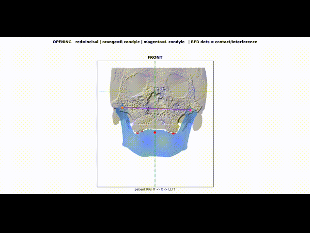
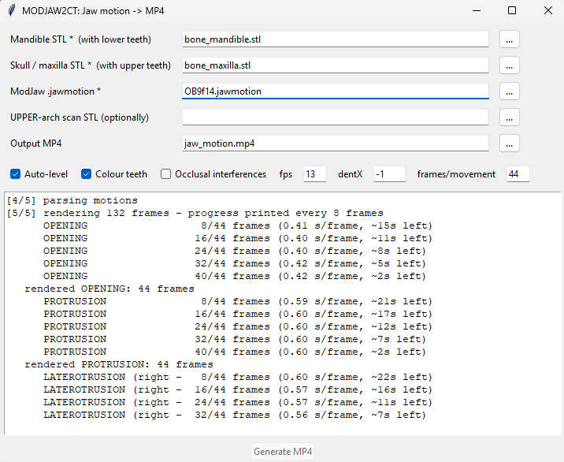

# MODJAW2CT
A visualization tool for integrating MODJAW motion recordings with cranial CT data to animate mandibular movement relative to the maxilla, visualize functional movement trajectories, and generate patient-friendly demonstration videos.


## Why Does It Matter?

Cranial CT and jaw motion tracking provide complementary information. CT reveals anatomical structures, while motion-tracking systems record the functional movements of the mandible over time.
However, these two sources of information are not always integrated into a single, intuitive visualization. Orthopedic and dental professionals may evaluate anatomical imaging and functional movement recordings separately, making it difficult to communicate how mandibular movement relates to the patient's craniofacial anatomy.

## How to use?

Install Python and the necessary libraries:

``` pip install numpy scipy trimesh open3d imageio imageio-ffmpeg ```

Run script:

``` python MODJAW2CT.py ```

Then, you need to load separate 3D scans of the mandible and skull (.stl , you need to segment them from the CT scan data using other tools), along with the motion file from MODJAW (.jawmotion). Click the "Generate MP4" button. Wait. The script will then generate a motion animation, plotting the mandible's trajectories, and record it as a video (mp4). Other script options are described in the code.

## Disclaimer

MODJAW2CT is intended solely for visualization and educational purposes, specifically to demonstrate mandibular movement to patients. It is designed to help patients better understand jaw movements by visualizing MODJAW motion recordings in the context of cranial CT data. This software is not intended for treatment-planning or clinical decision-making purposes. It does not provide medical diagnoses, and its visualizations should not be interpreted as a substitute for professional clinical assessment.

## Demo



